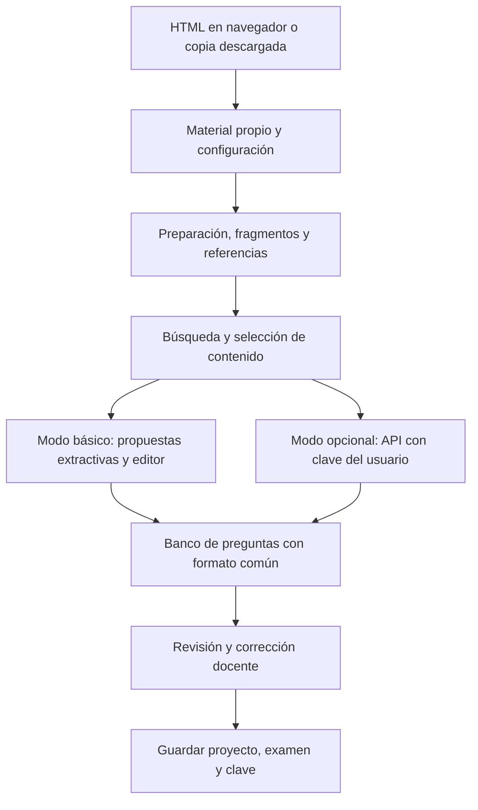

# Aula: requisitos, opciones y decisiones

**Fecha:** 26 de octubre de 2026.  
**Estado:** consolidación para decidir el alcance. No autoriza ni inicia la implementación real.

Este documento reúne las aclaraciones posteriores a la propuesta inicial. El [alcance común v0.2](ALCANCE_DE_LA_PROPUESTA.md) distingue el mínimo comprometido de las ampliaciones y es la referencia compartida con informe y demo. Distingue requisitos del estudiante, recomendaciones del asistente y asuntos que todavía deben comprobarse. El [plan de trabajo](PLAN_DEL_PROYECTO.md) traduce la recomendación en etapas.

## 1. Objetivo del integrador

Crear una herramienta útil para ayudar a un docente a preparar exámenes multiple choice a partir de material propio. Debe permitir configurar preguntas, revisar opciones y claves, conservar referencias y exportar el examen.

El valor académico está en aplicar y explicar contenidos de la cátedra: representación, calidad de datos, vectores y similitud, NLP, selección de información, modelos y evaluación de errores. Es un integrador de dos personas, no una tesis ni una plataforma educativa completa. No hace falta usar todas las técnicas ni entrenar un modelo grande.

## 2. Requisitos confirmados por el estudiante

| Requisito | Consecuencia para el diseño |
|---|---|
| Presupuesto del proyecto: cero | No contratar hosting, suscripciones ni APIs a cargo del grupo. |
| Uso gratuito y accesible para docentes | Debe existir un modo funcional sin pagos ni clave. La IA externa será opcional. |
| Hardware común y sistemas diversos | No depender de la Mac del estudiante, GPU ni un LLM instalado localmente. |
| Requisitos mínimos | Evitar instalaciones obligatorias y una cadena compleja de herramientas. |
| Flexibilidad | Web, HTML local, consola y herramientas externas son opciones; la demo en Pages no obliga a elegir web para todo. |
| Funcionalidad sin conexión | Sin internet debe poder continuarse un trabajo real, no solamente mostrar preguntas preparadas. |
| Ampliación mediante acceso del usuario | Una clave propia puede habilitar funciones adicionales; no convierte automáticamente ese uso en gratuito. |
| Uso de preentrenados permitido | No hay exigencia de entrenar desde cero. Un modelo pequeño propio sigue siendo una posibilidad. |
| Plazo acotado | Objetivo de dos semanas desde el 26 de octubre; tercera semana solo como margen. |
| Trabajo académico aplicado | Cada algoritmo añadido debe cumplir una función y tener una evaluación posible. |

La aceptación de llamadas opcionales pagadas por un usuario no se interpreta como autorización para contratar servicios o gastar dinero del grupo. El modo sin clave seguirá siendo gratuito y útil.

## 3. Estado real del proyecto

Ya existen propuesta consolidada v0.2 en Markdown/PDF, alcance común, plan, guion y una demo HTML pública en GitHub Pages. La demo permite configuración y revisión, pero utiliza seis ejemplos preparados y sus variantes.

**Todavía no existen:** procesamiento completo de material propio, recuperación real, un clasificador entrenado, generación mediante API, gestión de claves ni un modo offline funcional sobre documentos arbitrarios. Estas funciones se están planificando.

No hay proveedor ni arquitectura final aprobados. Tampoco se confirmó la dedicación semanal ni la devolución de los docentes.

## 4. Alternativas consideradas

| Alternativa | Ventaja | Limitación | Posición recomendada |
|---|---|---|---|
| Web en Pages + clave propia | Acceso por enlace y sin instalación de un programa. | Hay que comprobar solicitudes desde navegador, autenticación y cuotas de cada proveedor. | Candidata principal. |
| HTML descargable + funciones locales | Puede funcionar offline sin un servidor permanente. | Hay que incluir recursos y comprobar comportamiento en navegadores comunes. | Complemento principal de la web. |
| Consola multiplataforma | Facilita experimentos, lotes y conexiones con APIs. | Python/dependencias o paquetes por plataforma añaden requisitos. | Apoyo para desarrollo; interfaz alternativa si resulta necesaria. |
| Servidor remoto mantenido por el grupo | Centraliza procesamiento y conexiones. | Alojamiento, cuotas y operación; no hay presupuesto garantizado. | No asumir como requisito. |
| Modelo de lenguaje local | Evita pagar inferencia externa. | Descarga, memoria, instalación y tiempos; depende del equipo. | No será requisito para profesores. |
| OpenCode/Cline u otras herramientas | Puede aprovechar acceso que el usuario ya tenga. | Instalación e integración; una sesión existente no es una API universal para nuestra página. | Opcional y posterior. |
| Exportar instrucciones e importar resultados | Permite trabajar con otro asistente sin integrar cada plataforma. | Paso manual y validación del archivo devuelto. | Respaldo posible, no integración automática. |
| Modelo pequeño propio | Puede aportar aprendizaje supervisado y una función concreta. | Requiere ejemplos, etiquetas, comparación y distribución. | Solo si pasa un criterio de utilidad y tiempo. |

## 5. Arquitectura recomendada para discutir

**Una herramienta con un núcleo liviano y dos modos de uso.** Interfaz principal HTML/JavaScript, publicable en Pages y descargable. No construir simultáneamente una web completa, una aplicación de escritorio, una CLI de usuario y varios conectores.

Esta es una recomendación, no una promesa de compatibilidad ya comprobada. La primera prueba técnica debe decidir si se conserva el acceso directo a API desde navegador o se necesita otra modalidad.

## 6. Modo básico gratuito y offline

### Funciones mínimas propuestas

- Abrir texto propio y conservar la procedencia de sus fragmentos.
- Buscar conceptos y recuperar fragmentos mediante un método liviano, inicialmente TF-IDF y coseno.
- Crear preguntas manualmente con opciones, respuestas correctas y fuente.
- Proponer algunos borradores extractivos mediante reglas/plantillas, por ejemplo completar un término omitido de una definición. El usuario revisa enunciado, distractores y clave.
- Configurar una o dos respuestas correctas entre cuatro opciones; la propuesta automática inicial puede limitarse a una y permitir edición manual de ambas modalidades.
- Editar, aceptar, descartar y organizar preguntas.
- Guardar/importar el proyecto como archivo y exportar examen y clave separados.

La utilidad básica no dependerá de producir lenguaje nuevo. La búsqueda y las propuestas deben operar sobre el material cargado, no sobre el banco fijo de la demo. Los borradores extractivos no equivalen a preguntas de aplicación o razonamiento.

### Qué significa offline

Una copia descargada debe incluir los recursos necesarios para la parte básica. Abrir por primera vez una URL de Pages requiere conexión; no basta con llamarla “web” o haberla abierto antes para garantizar uso offline. Se recomienda comenzar con el HTML descargable antes de añadir caché/PWA.

No depender de fuentes, librerías o modelos cargados desde internet en el recorrido básico. Empezar por TXT, Markdown y pegado de texto. PDF con texto seleccionable será una ampliación si su extracción y dependencias resultan manejables.

## 7. Modo opcional con IA externa

El usuario seleccionará un proveedor compatible, un modelo e introducirá su clave para generar preguntas más variadas a partir de fragmentos seleccionados. No poner claves del grupo en el repositorio ni financiar solicitudes de visitantes.

Requisitos de diseño:

- Confirmación de qué material se enviará al proveedor y qué modelo se utilizará.
- Clave solo en memoria durante la sesión como opción inicial; no incluirla en exportaciones, logs ni repositorio. Esto reduce persistencia, pero el código ejecutado en la página puede acceder a ella.
- No confundir una suscripción de una aplicación con acceso API utilizable desde nuestra herramienta.
- Comprobar que el proveedor permita solicitudes desde navegador y cumpla sus condiciones de uso. JavaScript no evita las restricciones CORS.
- Mostrar errores de conexión/cuota y conservar el trabajo. No cambiar automáticamente a un servicio o modelo con costo.
- Ninguna clave será obligatoria para editar, guardar o exportar un examen.

No se promete acceso gratuito ilimitado de terceros. Si existe una modalidad gratuita utilizable, será una opción comprobada con sus límites; la herramienta básica no dependerá de su continuidad.

### Referencias consultadas el 26 de octubre de 2026

- [GitHub Pages](https://docs.github.com/en/pages/getting-started-with-github-pages/what-is-github-pages): aloja archivos estáticos; no ejecuta nuestro backend de inferencia.
- [OpenAI Docs: autenticación](https://developers.openai.com/api/reference/overview#authentication): recomienda no exponer claves secretas en código de cliente. BYOK requiere evaluar expresamente este manejo y las alternativas de conexión.
- [Anthropic: SDK TypeScript](https://platform.claude.com/docs/en/cli-sdks-libraries/sdks/typescript): documenta soporte de navegador desactivado por defecto por exposición de credenciales.
- [Cline API](https://docs.cline.bot/api/getting-started): documenta claves y ejemplos de modelos gratuitos; no se ha validado su uso desde nuestra página ni la cuota aplicable.
- [OpenCode: modelos](https://opencode.ai/v2/docs/console/models/): indica restricciones para usar modelos gratuitos de chat fuera de OpenCode. No asumir acceso libre desde clientes externos.

Estas referencias no sustituyen la prueba práctica del proveedor elegido y pueden cambiar.

## 8. Modelo pequeño propio: cuándo sí y cuándo no

Es opcional. No se propone entrenar un LLM. Una posibilidad es un clasificador temático de preguntas que ayude a detectar desvíos respecto del tema solicitado. Otra sería aprender a ordenar candidatos útiles si existen ejemplos etiquetados suficientes; no desarrollar ambas tareas por defecto.

Antes de elegirlo hay que responder: qué entrada recibe, qué salida produce, qué ejemplos reales tenemos, qué baseline supera y cómo se medirá. Si el tema ya se conoce por la sección del documento, no añadir un clasificador para redescubrir esa etiqueta sin utilidad.

Se puede comparar TF-IDF con K-NN o regresión logística y analizar su matriz de confusión. La división debe evitar que variantes casi idénticas de una misma pregunta contaminen entrenamiento y prueba. Clasificar un tema no comprueba la corrección de una clave.

El entrenamiento puede hacerse durante el desarrollo; el uso del modelo debe ser liviano. Si distribuirlo exige que el profesor instale herramientas o descargue un modelo grande, no cumple el requisito principal.

## 9. Qué elegir ahora y qué dejar pendiente

| Estado | Decisión |
|---|---|
| Confirmado | Cero presupuesto, accesibilidad, hardware común, utilidad sin API y revisión docente. |
| Recomendado | Web/HTML como interfaz principal y modo descargable offline. |
| Recomendado | Texto sencillo primero, recuperación liviana, banco editable y exportación. |
| Recomendado | Una sola integración API inicial; ampliar después de comprobarla. |
| Por comprobar | Proveedor, cuotas gratuitas, autorización de uso y acceso desde navegador. |
| Por decidir | Si incorporar un único modelo propio aporta valor dentro del plazo. |
| Posterior | CLI para usuarios, conectores de agentes, PWA, múltiples APIs y formatos complejos. |

## 10. Regla para decidir

No escoger la arquitectura por la cantidad de funciones que permite imaginar. Escoger la alternativa que complete un recorrido útil en un equipo común, sin gastos obligatorios, y que permita explicar y evaluar los conocimientos aplicados.

La primera entrega de desarrollo debe demostrar dos recorridos: **sin clave se termina un examen sobre material real**; **con una conexión compatible se incorporan propuestas de IA sin perder el control docente**. La vía avanzada mínima usa intercambio manual estructurado; una conexión API directa no se presentará como disponible sin comprobarla.
