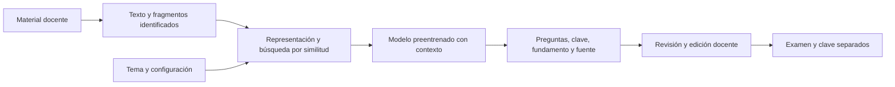

# Aula: plan del trabajo integrador

Actualizado: 26 de octubre de 2026. Este documento reemplaza el plan inicial más amplio, a partir de las aclaraciones del estudiante.

## Condiciones confirmadas

- Trabajo integrador de dos personas; no es una tesis ni un proyecto de investigación de gran escala.
- Debe aplicar conocimientos de la cátedra a una herramienta útil y permitir explicar decisiones y resultados.
- La cátedra permite modelos preentrenados y no exige entrenar uno propio desde cero.
- Hoy, 26 de octubre, hay que presentar la propuesta y una demostración sencilla para recibir devolución.
- La entrega de la propuesta cierra el 30 de octubre a las 00:00: conviene subirla durante el jueves 29.
- El desarrollo apunta a dos semanas, hasta el 9 de noviembre, con margen máximo orientativo hasta el 16. Estas últimas son fechas internas, no vencimientos oficiales.
- El estudiante autorizó ahora construir una demo interactiva sin IA. La implementación del sistema real sigue pendiente de la devolución y de acordar el siguiente paso.

## Proyecto propuesto

Asistente para preparar exámenes multiple choice a partir de material docente. El profesor elige tema, cantidad de preguntas y una o dos respuestas correctas entre cuatro opciones. Revisa preguntas, fundamentos y fuentes antes de exportar.

La utilidad principal es obtener un borrador verificable. El trabajo académico consiste en representar contenido, recuperar fragmentos pertinentes, usar generación con contexto y analizar resultados. La comparación TF-IDF/embeddings es una experiencia acotada que apoya la explicación, no el objetivo de demostrar una contribución científica.

## Recorrido funcional

## Qué se hará y cómo

| Parte | Implementación prevista | Relación con la materia |
|---|---|---|
| Preparar material | Extraer HTML/texto, limpiar navegación, dividir por secciones y conservar origen. | Representación y calidad de datos. |
| Buscar contenido | TF-IDF y coseno como referencia; embeddings y coseno como alternativa. | Vectores, normas, similitud, vecindad y NLP. |
| Generar preguntas | Un modelo preentrenado recibe contexto y formato solicitado. | Transformers, generación y RAG; distinguir inferencia de entrenamiento. |
| Comprobar y revisar | Verificar estructura y cantidad de claves; mostrar evidencia para revisión humana. | Evaluación, tipos de error y supervisión. |
| Analizar | Probar pequeñas solicitudes, comparar resultados y explicar fallos. | Baseline, experimentación y dominio de validez. |

No llamaremos clasificación K-NN al simple ranking documental sin etiquetas. No incorporaremos clustering, redes entrenadas propias o algoritmos genéticos solo para sumar técnicas.

## Alcance mínimo y límites

Incluye material textual de tres unidades, una sola conexión generativa, cuatro opciones y una/dos respuestas correctas, revisión y exportación simple. PDF con texto seleccionable queda sujeto al tiempo disponible.

Quedan fuera OCR, manuscritos, análisis de imágenes/fórmulas, dificultad pedagógica automática, corrección de alumnos, personalización adaptativa, cuentas, campus virtual y despliegue público.

No se presupone GPU ni un proveedor específico. Se comprobará una integración disponible con una solicitud pequeña antes de construir alrededor de ella. La selección de modelo y costos sigue pendiente; el permiso académico para usar preentrenados ya está confirmado.

## Pruebas proporcionadas al alcance

1. Elegir tres unidades y revisar que el texto extraído conserve significado.
2. Preparar algunas solicitudes literales y otras expresadas como paráfrasis. Anotar qué fragmentos deberían recuperarse.
3. Usar solicitudes de desarrollo para ajustar la segmentación y reservar otras para la comparación final.
4. Comparar TF-IDF y embeddings con las mismas solicitudes; observar si aparece evidencia pertinente y en qué posición.
5. Mantener el mismo generador e instrucciones para comparar preguntas. Una muestra inicial de unas 20 preguntas revisadas puede ser suficiente para detectar problemas y preparar el informe; ajustar la cantidad al tiempo real disponible.
6. Revisar clave, claridad, tema, respaldo y formato. Registrar cuáles se aceptarían, editarían o descartarían y por qué.

Ambos integrantes revisarán la muestra y discutirán diferencias consultando las fuentes. Una revisión docente sería valiosa, pero no se da por confirmada. La revisión interna no demuestra eficacia pedagógica ni dificultad real. No hace falta un estudio estadístico amplio ni prometer que un método superará al otro.

## Cronograma y reparto

| Etapa | Resultado |
|---|---|
| Hoy | Informe breve y demo sin IA, listos para presentar. |
| Después de la devolución | Ajustar alcance, elegir corpus y comprobar acceso al modelo. |
| Semana 1 | Texto limpio, fragmentos, representaciones y búsqueda funcionando. |
| Semana 2 | Generación, revisión, exportación y pequeña evaluación con ejemplos. |
| Margen de semana 3 | Corregir problemas y atender observaciones; no ampliar funciones por defecto. |

Un integrante puede concentrarse en material/recuperación y otro en generación/revisión. Ambos deben participar en las pruebas y comprender el procedimiento completo. El reparto personal y las horas disponibles deben acordarse con el compañero.

## Riesgos prácticos y respuesta

- **Extracción difícil:** mantener HTML/texto y postergar PDF.
- **Generación incorrecta:** mostrar fundamento, conservar revisión y permitir descarte.
- **Acceso al modelo:** verificar temprano disponibilidad y presupuesto; reducir volumen o cambiar una integración si fuera necesario.
- **Poco tiempo:** conservar el flujo completo y recortar interfaz y formatos secundarios.
- **Respaldo insuficiente:** informar que no hay material suficiente para la pregunta solicitada.

## Material listo para hoy

- [Informe editable](PROPUESTA_PARA_ENTREGA.md).
- [Informe PDF](output/pdf/PROPUESTA_PARA_ENTREGA.pdf).
- [Demo HTML independiente](demo/index.html).
- [Guion y pasos de demostración](GUIA_PARA_PRESENTAR.md).

La demo usa ejemplos preparados y no tiene IA conectada. La carga permite previsualizar texto local; para construir el examen simulado se utiliza el apunte incorporado. No hay almacenamiento persistente ni envío de archivos a servicios externos. Todavía no se subió ningún archivo a la entrega de la cátedra.
